# AI Travel Agent

> **Dalili 2.0 - development copy.** Work on the new version happens here (see `Dalili_2.0_Plan.md`).
> - The original, untouched project is in `..\grad project`.
> - A full backup is in `..\Dalili_backup_2026-09-30.zip`.
> - Run with `.\run.ps1`, which uses port **8001** so both versions can run side by side.

**Dalili** (دليلي, "my guide") is an agentic AI travel planner that **researches, optimizes, validates, personalizes and continuously replans** a complete trip from **real data**, for any city with an airport. It never books anything: the AI plans, the user books (every flight and hotel carries its booking link).

```
LLM understanding (Claude)  +  LangGraph orchestration  +  8 MCP servers over real APIs  +  structured Trip State
+  OR-Tools day optimization  +  8 deterministic validators  +  repair loop  +  feedback learning  =  Trip Book
```

## Model

The default model is **gpt-5-mini on Azure AI Foundry**, called through the OpenAI **Responses API**
(`AZURE_AI_ENDPOINT=.../openai/v1/responses`, `AZURE_AI_MODEL=gpt-5-mini`, `AZURE_AI_REASONING_EFFORT=low`).
A `.../chat/completions` endpoint still works for chat-completion models, and Claude remains an option
(`TRAVEL_AGENT_LLM_PROVIDER=anthropic`). Every call falls back to deterministic code if the model is unavailable.

## Planning intelligence

- **Icons first.** Sights are ranked by real fame (Google review volume, log scale) as well as the traveller's interests, so a first-time
  visitor always gets the Colosseum, the Eiffel Tower and similar landmarks. The city's top landmarks survive budget price caps, and the critic agent can never remove one on its own.
- **Every free hour counts.** Arrival and departure days get capacity from the real hours left after the flight. Idle afternoons are filled
  with nearby open sights (also borrowed from later, busier days) instead of "free time": one extra stop per gap for a moderate pace, up to six for a very active one.
  After dinner, active travellers get an evening walk (squares and fountains).
- **Smarter flights.** A Google Flights **round-trip ticket** is searched as well (2 searches) and used when it beats two one-ways. The two legs are
  only ever chosen together. Flight choice weighs usable hours in the destination: a direct flight landing at 07:10 beats a cheaper one landing at 11:30
  on a short trip. When nothing fits the budget, the planner may spend up to ~2% more than the absolute cheapest for a much better trip.
- **Honest budgets.** When the gap is in flights or the hotel, the repair loop no longer strips sights and meals for nothing. It keeps the experience, and the reply
  shows the cost breakdown, the cheapest possible flights + hotel, a realistic budget and the flight alternatives (cheapest, most time, direct).
- **Conversation.** The model understands casual requests in any dialect ("ضيف حاجات تانية" = more stops, "I'm active", "walk nearby, transport for far").
  The reply model decides what to ask from the preferences it doesn't know yet. It writes its own 2-4 one-tap suggestions for this trip;
  there are no fixed quick replies. One trip agent reads every message (before the plan, while a route waits for an answer, after planning)
  and decides whether to answer from live tools or change the trip. The rule-based parser exists only for the offline test suite.
- **Memory.** Short-term: the last 12 messages. Long-term: preferences the traveller states about themselves (pace, transport, diet, interests…) are kept with
  high confidence and carried into their next trips, alongside preferences learned from feedback.

## AI agents (`travel_agent/agents/`)

| Agent | Pattern | What it does |
|---|---|---|
| **Critic** (`critic.py`) | Reflection with verification | Reviews every new plan like a senior travel planner: a missing icon, an overloaded day, outdoor visits on the rainy day, fit with the traveller's requests. Whitelisted, data-grounded fixes (add a researched place, lighten a named day, replace an activity that is in the plan…) are applied, then the plan is re-planned, re-validated and re-scored. It is kept only if it isn't worse (no new errors, TripScore within 1 point); otherwise it is rolled back. Other issues become one-tap suggestions. |
| **Trip agent** (`concierge.py`) | ReAct, tool use | Once a plan exists, **every message goes to this agent**, and it decides what the message needs. It can look things up and answer ("sushi near my hotel?", "will it rain on day 3?"), or change the trip through its `change_plan` tool, often after looking something up first: "add a sushi place for dinner on day 1" → `search_nearby` → adds the real restaurant as that dinner; "take the direct ITA flight" → `flight_options` → `choose_flight`. Tools: `plan_lookup`, `search_nearby`, `find_place`, `directions`, `weather`, `convert_currency`, `travel_guide`, `flight_options`, `change_plan`; at most 5 steps. The deterministic planner then rebuilds, validates and repairs the plan: **the agent decides, code verifies the numbers.** |
| **Review analyst** (`review_analyst.py`) | Aspect-based sentiment | Reads real Google Hotels reviews of the chosen hotels: a verdict, a 1–5 score per aspect, pros and cons (EN + AR), and a noise level. Quoted evidence must appear verbatim in the reviews. |

- Every agent returns a Pydantic schema, has hard step limits, and falls back to deterministic code without a model.
- **Memory.**
  - *Short term:* the Trip State (draft, contract, plan, pending question) plus the last 6 chat messages (`memory.py`). The model sees both, so "the second one" or "التاني" resolves to the option just offered.
  - *Long term:* per-user learned preferences with confidence and evidence (`profile.learned`, inherited by new trips), account preferences, and the activity log the recommender learns from.
- Every step is recorded in `trip.metadata["agent_trace"]`; **How I answered**, under every reply, shows what each agent thought.
- Tests (`tests/test_agents.py`) drive the agents with a scripted model over recorded real data.

## Hajj & Umrah (`pilgrimage.py`, the **Hajj & Umrah** page)

- **An Umrah is planned like any trip, around the prayers.** "عايز أعمل عمرة…" → Makkah then Madinah (about two thirds
  of the nights in Makkah unless the traveller chooses), flights to Jeddah / Madinah, the Haramain train between them.
  - Makkah and Madinah are recognised by where they are (near the two Holy Mosques). A city with no airport of its
    own (Makkah, Petra…) is flown to through its nearest airports, each confirmed by Google Flights and Wikipedia.
  - The hotel's walk to the Holy Mosque leads the choice ("About 6 min walk to Masjid al-Haram"), within the budget.
  - The sacred sites are a fixed list placed with Wikipedia's coordinates (no tourist search, no search credit). The
    Umrah itself is planned on the first days in Makkah and the visit to the Prophet's Mosque in Madinah, never
    squeezed out; then Quba, al-Qiblatayn, Uhud, Jabal al-Nour, Arafat…
  - Every day shows the five prayer times (Aladhan, Umm al-Qura); Ramadan and the Hajj season are flagged.
- **Hajj is never planned** (permits only through official channels): the reply explains the channels.
- **The page:** the Umrah and Hajj rituals step by step, the miqat, prayer times for Makkah / Madinah, the expected
  dates of the next Hajj, a checklist, and a short form that hands an Umrah to the planner. The guidance is fixed text
  following the widely published practice (never written by the model), and points to a scholar for rulings.

## Landmark camera (`agents/landmark.py`)

📷 in the chat box (or "What's this place?" on the home page): a photo of a monument, a mosque, a bridge… becomes
the place it shows and a guide to it you can question, then "Plan a trip here".

1. The photo is resized on the device (~1280 px) and read by gpt-5-mini (it sees images); it is never stored.
2. The model names the landmark (its English Wikipedia title, up to two alternatives) or says it can't tell.
3. Wikipedia must have the article, about the same subject, with coordinates - and Wikidata's country must agree
   with the model's. Otherwise the next alternative is tried (then shown only as a best guess), then "not sure".
4. The guide (what it is, history, visiting tips) and every answer afterwards are written from the article's text,
   in the traveller's language. Live: the Treasury at Petra, the Sagrada Família and the Trevi Fountain recognised
   in 6-15 s; a cat photo is "not a landmark".

## World events (`providers/world_events.py`, the **Events** page)

Championships, Grands Prix, world-famous festivals, carnivals and celebrations in the next ~13 months - one tap
("Plan a trip for this") plans a trip around one. Free sources only, and nothing is shown unchecked:

1. The model proposes the events (six areas in parallel, one of them the Arab world).
2. Wikipedia must have the article (a redirect or search hit counts only when it is the same event and edition),
   or the event is dropped. Wikidata says how famous it is (articles in other languages), and gives the dates when
   the edition has them, the Arabic name and the official site.
3. Otherwise the official website: the next edition's dates and cheapest ticket, each with a verbatim quote.
   Dates nobody publishes are shown as **usual dates · confirm**, an unpublished ticket as an AI estimate.

The catalogue is rebuilt in the background twice a day (~1 min). During a trip, the big events in its countries on
its dates are **offered** in the reply ("Oktoberfest is on during your stay - from 25 EUR - want to go?"). A "yes" in
any words makes the trip agent add it, and the planner puts it on one of its dates with its ticket in the budget.
An event that wasn't accepted never enters a day, a cost estimate or the expert review.

## Accounts, dashboard and personal recommendations

**Accounts** (`travel_agent/auth.py`, standard library only):
- **Sign up and sign in.** Passwords are hashed with scrypt and a per-user salt.
- **Sessions.** A random token in an HttpOnly, SameSite=Lax cookie. Only its SHA-256 is stored, and a session expires after 30 idle days.
- **Protection.** Failed sign-ins are rate limited per email and per IP. A wrong email and a wrong password give the same answer. Cross-site POSTs are blocked.
- **Privacy.** Every trip belongs to its owner; someone else's trip answers `404`.
- **Guests.** Anyone can plan without an account, using a guest cookie. Signing up or in moves the guest's trips to the account.
- **Account settings.** Change name, home city, currency and interests; change password (which signs out other devices); delete the account.
- **Before accounts.** Trips planned before accounts existed (owner `default`) go to the first account created on the server.

**Dashboard.** The avatar at the top right opens it:
- the next trip, and stats (trips, countries, travel days, average TripScore);
- *Picked for you*, the travel-taste profile and a taste map;
- *My trips* (all / upcoming / past / drafts; open or delete);
- *Settings*.

**Recommendation model** (`travel_agent/recommender/`) is a **pretrained language model (MiniLM) fine-tuned by knowledge distillation**: gpt-5-mini reads the Wikivoyage guides of 227 destinations and describes each one; the small model is fine-tuned to carry that understanding, then exported to ONNX (int8, 23 MB). The website runs it with ONNX Runtime - no PyTorch, no API call.
- One vector per place; a city outside the catalog is embedded from its guide on the fly.
- A user's taste is the weighted, time-decayed mix of the places they planned, searched, opened and liked. It also includes the interests they picked; dismissed places count against it.
- Each suggestion states why it was made ("Because you planned Rome") and what the place is known for.
- It is evaluated against hand labels (never used in training) on a held-out test split, next to the model before fine-tuning, the teacher, a TF-IDF baseline and random.
- Everything about the model is in [`ml/`](ml/README.md): the write-up, the notebook (`ml/recommender.ipynb`), the dataset and the trained model. Retrain with (needs `ml/requirements.txt`):

```powershell
python -m travel_agent.recommender.finetune --tune   # teacher (cached) -> fine-tune -> ONNX -> evaluate on test
```

## Real data sources

| Domain | Source | Used for |
|---|---|---|
| Flights | **SerpApi** Google Flights, Flights Autocomplete | real fares & schedules, airport/city ids |
| Hotels | **SerpApi** Google Hotels, Hotels Reviews | real nightly prices, ratings, amenities, noise from guest reviews |
| Places / food | **SerpApi** Google Maps (+ web search for menus) | restaurants & sights with real opening hours, ratings, review counts, price ranges |
| Activities | **SerpApi** Google Maps + Google Events (falls back to Google Search events) + Travel Explore; **OpenTripMap** | top sights, less-visited places with Wikipedia descriptions, local events, destination ideas |
| Transport | **SerpApi** Google Maps Directions; **openrouteservice** matrices | airport transfer times (transit / driving); real walking & driving times between every stop |
| Geocoding | **Geoapify** + Google Flights autocomplete | coordinates, country, timezone, airports |
| Weather | **Open-Meteo** forecast / historical archive | live forecast ≤15 days; beyond that, last year's observed weather (flagged) |
| Currency | **Frankfurter v2** (central banks) | conversion of every price into the traveler's currency |
| Knowledge (RAG) | **Wikivoyage** + CLDR (Babel) | Understand / Get around / Respect / Stay safe sections, phrasebook, emergency info, currency & languages |

### Honesty rules

No API publishes everything a planner needs, so the system labels every fact it didn't get from a provider:

- `price_type="known"` for Google Flights/Hotels prices and listed price ranges. Entry tickets and most meal prices are **estimates**, scaled by the city's price level (derived from real hotel prices) and shown as such.
- `hours_verified=False` when Google has no opening hours. Typical hours are then assumed, the validator only *warns* about them, and the itinerary says "check before going".
- Weather beyond the forecast range is last year's real observations, with confidence 0.35.
- Unknown hotel cancellation terms and noise levels are shown as unknown, never guessed.

The eval measures this: about **52%** of plan cost is backed by published prices (flights, hotels, listed ranges), and about **87%** of scheduled places have verified opening hours.

## Quick start (Windows PowerShell)

```powershell
python -m venv .venv
.\.venv\Scripts\pip install -r requirements.txt
copy .env.example .env      # add SERPAPI_API_KEY, ORS_API_KEY, OPENTRIPMAP_API_KEY, GEOAPIFY_API_KEY (+ optional ANTHROPIC_API_KEY)
.\.venv\Scripts\python -m uvicorn travel_agent.api:app --port 8000
```

Open http://127.0.0.1:8000 and try:

> *Barcelona December 4 to 9 from Dubai, 2 people, 4000 USD, we love art, architecture and nightlife, direct flights only*

Then: *"make it cheaper"*, *"remove two museums"*, *"I don't want to wake up before 10"*, *"what if I increase my budget by $500?"*, *"I want to stay two more days"*, *"do I need to tip?"*, or **Open Trip Book**.

## Price certainty

Every price carries `price_type` and a `source`:

| Type | Meaning | Examples |
|---|---|---|
| `known` ✓ | Published by a source | Google Flights / Hotels; Google Maps transit fare (`cost` + `currency`); Wikivoyage listing price edited in the last 3 years; an official fare quoted **verbatim** from the city guide |
| `range` | A published per-person range | Google's "€10–20" for a restaurant |
| `calculated` | The official taxi tariff × the real road distance | flag fall + €/km quoted from the guide |
| `estimated` | Nothing publishes it | shown as "≈" or "price not published", never as a fact |

**Price cascade** (`pricing.py`): every price goes through its sources, most certain first. None of them costs SerpApi credits.

| Item | Order of sources |
|---|---|
| Entry tickets | Google Maps → **the place's official website** → Wikivoyage listing (< 3 years) → AI estimate for that exact place → generic estimate |
| Restaurants | Google price range → Wikivoyage → **the restaurant's own menu page** (range of main-course prices) → AI estimate |
| Transport | Google Maps transit fare → official tariff quoted in the city guide → AI estimate for the city |

- **Official websites** (`providers/official_prices.py`): the pipeline follows the "tickets / prices / tarifário / biglietti / menu" link **on the same site**, turns the page into text, and the model extracts the price. The price is kept only if:
  - its quote is **verbatim** on the page;
  - the quote contains the number;
  - for tickets, it isn't a child, senior, student or family price.
- **Limits and cost:** 12 sights and 8 restaurants per city, run in parallel with a 35-second limit and a 30-day cache.
- **Agreement:** when two published sources agree within 15%, the price is marked "confirmed".
- **AI estimates:** they run alongside the official checks, in one batched model call per city, and an official price found meanwhile always wins. They are labelled "AI estimate", carry a confidence level, and are never shown as ✓.

Live, Lisbon, 0 SerpApi credits: official 2026 prices for Castelo de São Jorge (€17, confirmed by Wikivoyage), Quinta da Regaleira (€20), Belém Tower (€15) and Padrão dos Descobrimentos (€10), plus a restaurant menu.

- **Quote verification:** the model reads the Wikivoyage "Get in / Get around" text (`providers/local_prices.py`). A fare is accepted only if the quote:
  - appears word for word in the text;
  - contains the number;
  - says what the price is for (ticket, taxi, train…);
  - isn't dated before 2020.
- **Wikivoyage listings** are parsed from wikitext, from the city article and its district articles. They are matched to places by name and location, and a site is never confused with its museum.
- **Older prices:** a listing price older than 3 years, or undated, is only a reference and stays estimated.
- **Transparency:** the Budget tab shows the share of the total that rests on published prices, and the Sources tab shows every quote.

## SerpApi quota (free plan: 250 searches / month)

**Credit savings:**

| Measure | Detail |
|---|---|
| Attraction searches sized to the trip | 1 for short trips; an interest search from 3 days; day trips from 4 days; the country from 6 days |
| Free candidates | OpenTripMap and Wikivoyage |
| Events | Only for travellers into nightlife, music or culture |
| Hotel reviews | Only for the chosen hotel, after the critic has finished; for noise-sensitive travellers only, also before choosing |
| Cache lifetimes | Attractions 30 days, restaurants 21 days, directions 30 days |
| Per-turn cap | 20 |

Measured results:
- New city: 11 searches, down from 17–21.
- A city seen within the cache lifetime: about 5 searches (flights + hotel).

The rest of this section describes the quota mechanics:

- A new trip costs about **25–30 searches**. Replans that don't change dates, city or travelers cost **0** (pure re-planning over cached research). Changing dates costs about 3.
- Every response is stored in a persistent cache (`.cache/http_cache.sqlite`) with per-source TTLs (flights and hotels 6 h, places 7–14 days, reviews 30 days…). Engines missing from the plan (e.g. `google_events`) are remembered so they aren't retried.
- `TRAVEL_AGENT_SERPAPI_CALLS_PER_TURN` (default 20) caps live searches per chat turn; `/api/quota` (operator token) shows what is left this month.
- API keys are stripped from cache keys and stored rows, redacted from every error message, and kept out of logs.

## Tests and evaluation, with no quota spent

Tests and the eval **replay real API responses** recorded in `tests/fixtures/http_cache.sqlite` (Rome, Istanbul, Barcelona sessions). They run offline, deterministically, and never touch the quota.

```powershell
.\.venv\Scripts\python -m pytest -q          # the whole suite, replay mode (no live calls)
.\.venv\Scripts\python eval\run_eval.py      # 26 scenarios + metrics -> eval/REPORT.md
$env:RECORD="1"; .\.venv\Scripts\python -m pytest   # re-record after changing queries (uses live APIs for misses)
.\.venv\Scripts\python eval\run_eval.py --record
```

| Metric (real recorded data) | Result |
|---|---|
| Scenarios passed | 26 / 26 |
| Constraint satisfaction (all checks, all modes) | 99.8 % |
| Schedule feasibility | 100 % |
| Budget accuracy | 100 % |
| Tool selection accuracy | 100 % |
| Grounded recommendation rate | 100 % |
| Reality violation rate | 0 % |
| Injected-violation detection (closed restaurant/attraction, delisted activity, long walk, overlap, hallucinated place) | 100 % |
| Replanning success | 100 % |
| Cost backed by published prices | ~52 % |
| Scheduled places with verified hours | ~87 % |

Live, uncached (measured): a new trip's plan is on screen after about 55 s and the whole answer takes about 70 s (live searches, price research and an expert review; the same trip took 88 s before the slow steps were overlapped); a change to a plan about 20–30 s; a question about 10–15 s. The plan is shown as soon as it is built, while the expert reviews it and the reply is written alongside the review. Under every reply, **How I answered** shows the route the message took and where the time went.

## Architecture



```text
            chat UI + live trip board (frontend/)  ──  FastAPI (api.py)  ──  service.py (sessions, what-if, SQLite)
                                                      │
LangGraph Travel Manager (workflow.py)
START → understand ─┬→ answer (Wikivoyage RAG) ───────────────────────────────────────────→ END
                    ├→ check_requirements → resolve places (Google autocomplete + Geoapify) ─┬→ ask → END
                    └→ apply_feedback ──────────────────────────────────────────────────────┤
                                                                                            ↓
     research_setup → [flights | hotels | restaurants | attractions+events | weather]  (parallel)
                    → collect + enrich: FX for every currency · city price level · airport transfers
                                        · hotel noise from reviews · ORS walk/drive matrices
                    → plan → validate ─┬→ repair → plan   (loop)
                                       └→ finalize (TripScore, diff) → respond → END
                                                      │
                             MCP client hub (in-memory or stdio) → 8 MCP servers → net.py (cache, quota, redaction)
```

| Concept section | Where |
|---|---|
| Trip State, Trip Contract, Traveler Profile, PlaceRef, metadata | `travel_agent/models.py` |
| MCP servers + client | `travel_agent/mcp_servers/*`, `travel_agent/mcp_hub.py` |
| Real providers | `travel_agent/providers/` (flights, hotels, places, events, routing, weather, currency, geo) |
| HTTP cache / record-replay / quota | `travel_agent/net.py` |
| Research agents + enrichment | `travel_agent/research.py` |
| Optimization (VRP with time windows) | `engine/optimizer.py` |
| Itinerary, food timeline, energy-aware days | `engine/planner.py` |
| Validators, repair loop, TripScore | `engine/validators.py`, `engine/repair.py`, `engine/scoring.py` |
| Feedback, learning, targeted replanning, diffs | `replanner.py` |
| Understanding (Claude structured outputs + rules) | `nlu.py`, `llm.py` |
| RAG knowledge | `knowledge.py` |
| Trip Book (21 sections) | `tripbook.py` |

## MCP servers and tools

| Server | Tools |
|---|---|
| flight_mcp | `search_flights`, `search_one_way_flights` |
| hotel_mcp | `search_hotels`, `get_hotel_reviews`, `get_hotel_offers` |
| places_mcp | `search_restaurants`, `search_places` |
| activities_mcp | `search_attractions`, `search_events`, `get_major_events`, `explore_destinations`, `find_place` |
| transport_mcp | `get_directions`, `get_airport_transfers`, `get_intercity_journeys` |
| weather_mcp | `get_weather_forecast` |
| currency_mcp | `get_exchange_rates`, `convert_currency` |
| knowledge_mcp | `resolve_place`, `resolve_destination`, `get_destination_info`, `get_local_prices`, `get_transport_fares`, `get_menu_price`, `get_official_price` |

Each server runs standalone over stdio (`python -m travel_agent.mcp_servers.flights`), or in-process. Set `TRAVEL_AGENT_MCP_TRANSPORT=stdio` to spawn them as separate processes.

## API

| Method | Path | Purpose |
|---|---|---|
| POST | `/api/chat` | `{message, trip_id?}` → reply + full trip state |
| GET | `/api/trips/{id}` | Trip State |
| POST | `/api/trips/{id}/select` | balanced / budget / comfort / experience |
| POST | `/api/trips/{id}/whatif` | `{budget_delta \| budget, apply}` → comparison on a copy |
| GET | `/api/trips/{id}/book` | Trip Book |
| GET | `/api/health`, `/api/quota`, `/api/mcp/tools` | status, SerpApi usage, tool discovery |
| POST | `/api/auth/signup`, `/api/auth/signin`, `/api/auth/signout` | accounts (session cookie) |
| GET | `/api/auth/me` | the signed-in user, or `null` for a guest |
| PATCH / DELETE | `/api/me` | profile and preferences / delete the account (password required) |
| POST | `/api/me/password` | change password (other devices are signed out) |
| GET | `/api/me/dashboard` | stats, next trip, all trips |
| GET / DELETE | `/api/trips`, `/api/trips/{id}` | the caller's trips / delete one |
| GET | `/api/recommendations`, `/api/recommendations/similar?city=`, `/api/recommendations/map` | personal picks, similar places, taste map |
| POST | `/api/activity` | `{kind: search \| view \| like \| dismiss, city}`: what the recommender learns from |
| GET | `/api/recommendations/model` | the model's evaluation report |
| GET | `/api/events?category=&country=` | world-famous events in the coming months (`complete=false` while still being checked) |

## Known limits

- Entry-ticket prices and most restaurant prices aren't published by any of these APIs. They are estimates and are labelled as such.
- Public-transport time inside a city is estimated from ORS driving time (ORS has no transit). Airport transfers use real Google transit times.
- `google_events` isn't available on the free SerpApi plan. Events then come from Google Search's events block when Google shows one.
- Train / coach legs between cities use real Google Maps travel times, but the departure slots (09:30 / 14:00) and fares are estimates, labelled as such. No free API publishes rail timetables or fares.
- Next steps: PostgreSQL + pgvector and a Next.js frontend (§52 stack).

## Route design with the traveller (countries → cities)

When you name countries or a region instead of cities (*"a Europe tour: Spain, Italy, France, I want the Leaning Tower of Pisa, the Eiffel Tower and the church in Barcelona"*), the agent doesn't pick one city per country. It proposes a route and waits for your answer (`route_design.py`):

1. The places you named are located on Google Maps (real coordinates).
2. The LLM designs bases, nights and day trips, e.g. Florence as the base for Pisa.
3. Every city is checked against real data. Any named place that ends up more than ~150 km from every base is sent back to the model once. If it's still uncovered, that country's base is moved next to the place: the place's town comes from Geoapify reverse geocoding.
4. The order is optimised for the shortest total travel (unless you asked for an order), and nights are fitted to your dates.
5. The proposal appears in the chat and on the globe. Click **Plan this route**, or answer in your own words in any language: more nights somewhere, other cities, drop a country, "you decide". The model understands the answer, not keyword rules, and each change produces a new proposal. Research starts only once you accept.

**Places by name:** at any point you can say *"add the Vatican Museums"*. The place is found (researched data first, then Google Maps), forced into every plan mode on the best day, and marked "★ you asked". Places too far for a day trip are explained, not squeezed in.

**LLM availability:** understanding in any language needs the LLM. If it's unavailable (e.g. the Azure AI key is rejected or its quota is reached), Dalili says so in the chat instead of guessing with keywords; the route button still works.

## When a live source runs out: AI knowledge fallback

Live data stays the source of truth. When a tool's live source fails (e.g. SerpApi "Your account has run out of searches", or an outage), the MCP tool falls back to the LLM (`providers/ai_fallback.py`) instead of returning nothing:

| Tool | Fallback |
|---|---|
| Flights (both directions and multi-city legs) | Airlines that fly the route, typical times and durations, estimated fares, and a Google Flights search link. Also used when a live search returns no flights. |
| Hotels | Real hotels across price levels with estimated nightly prices; locations checked with Geoapify. |
| Attractions, restaurants, a named place | Well-known real places with typical hours and estimated prices; locations checked with Geoapify. |
| City / airport resolution | Geoapify for the city, the LLM for its airports. |
| Airport transfers | Airport located with Geoapify; time and fare estimated from the distance. |
| Intercity ground legs | A coach estimate from the distance (not a train, which may not exist). |

Everything from the fallback is labelled: `metadata.source = "ai_knowledge"`, `price_type = "estimated"`, unverified hours and low confidence. The board shows "AI estimates · verify before booking", and the chat reply says live search was unavailable. Without an LLM, the tool reports the live error as before. Open-Meteo (weather), Frankfurter (FX) and Wikivoyage need no quota and stay live.

## Multi-city journeys

Say *"a Europe tour: Italy, France and Spain, 10 days from Oct 20, $4,500 for two"*, *"Rome then Paris then Barcelona"* or *"3 nights in Rome, 2 in Florence and 4 in Venice"* (`journey.py`):

- **Understanding:** the LLM fills `destinations` (plus `nights_per_destination` when given). A rule-based parser backs it up. Countries resolve to their main city. Nights are split evenly when you don't give a split.
- **Research:** each city is researched like a single destination, in parallel (hotels, sights and day trips, restaurants, events, weather, local prices, airport transfers). Every leg (origin → city 1 → … → origin) gets a one-way Google Flights search when the cities are ≥ 350 km apart, and a train / coach option (Google Maps) when they are ≤ 700 km apart. The planner picks the best one.
- **Planning:** each city is planned with the normal engine and its share of the budget. The journey that leaves one city is the one that arrives in the next. The day you move becomes one travel day: morning in the first city, arrival afternoon or evening in the next. Budget, validation, repair and TripScore then run on the whole journey.
- **UI:** the globe spins, with live air traffic, until the destinations are known. It then stops, draws every leg in turn with a plane flying the route, and zooms to fit the route in the free space between the chat and the board. The board shows a route strip, each day's city, per-leg cards and a hotel per city. The Trip Book adds a Journey section, a Hotels section and per-country phrases and emergency info.
- **Cost:** a 3-city trip uses about 30 SerpApi searches. The per-turn cap is raised automatically, by 18 searches per extra city.
